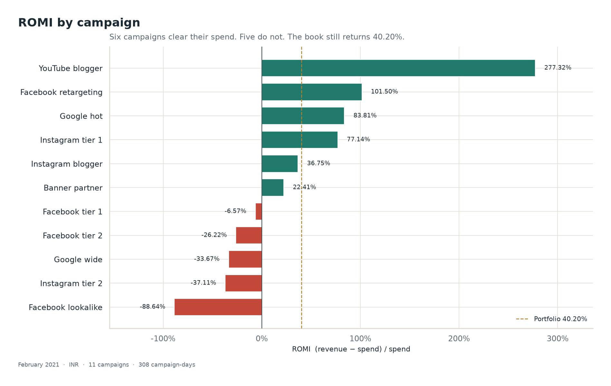
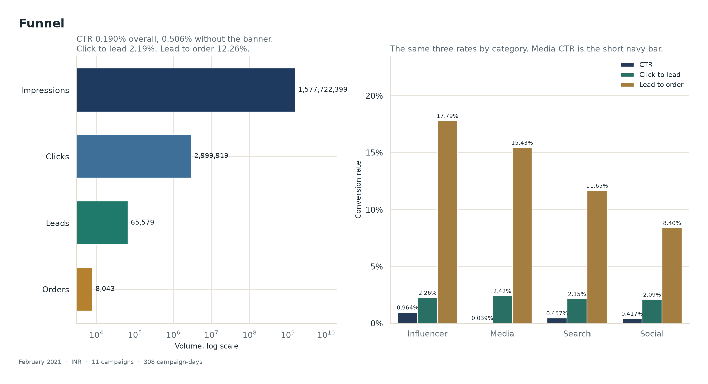
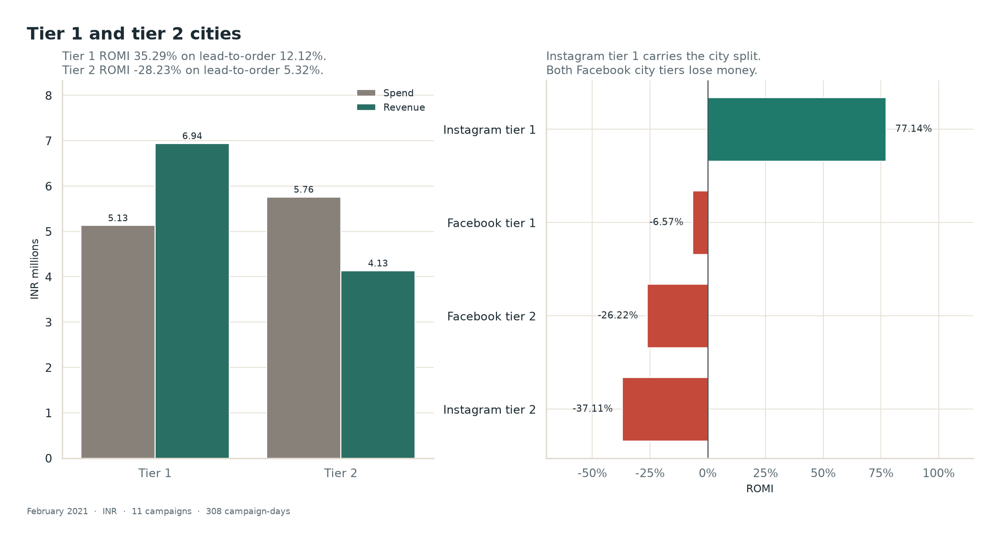
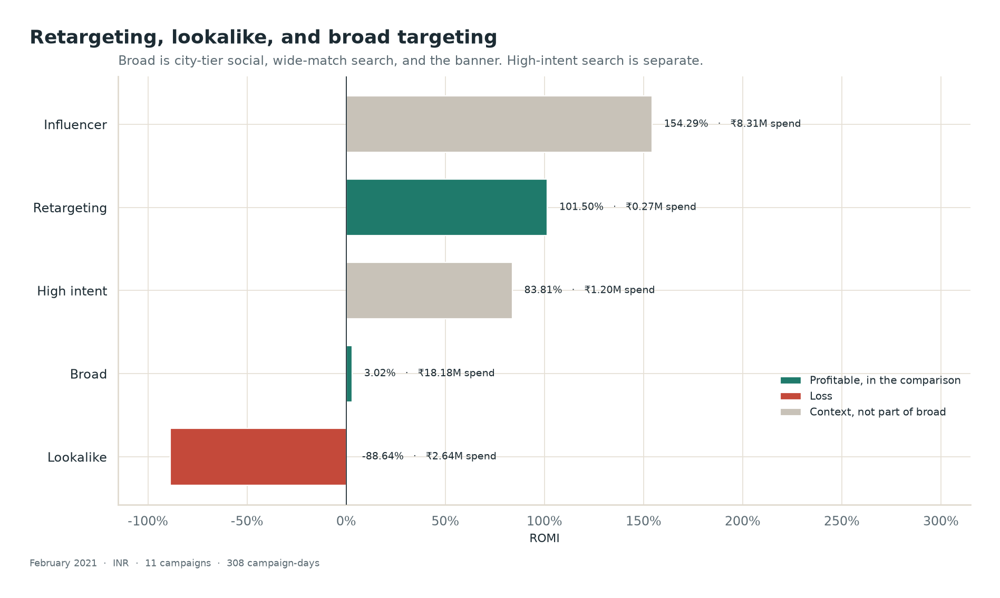
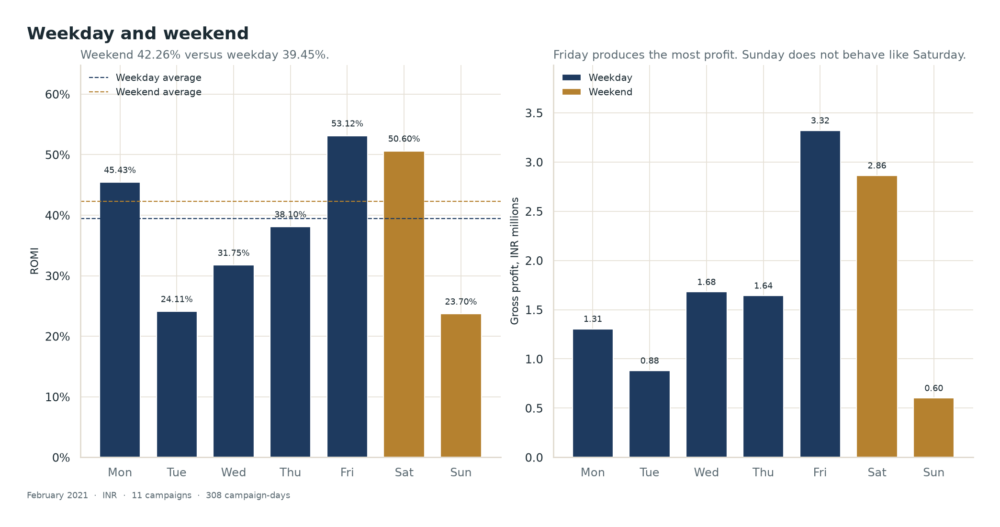

# Digital marketing campaign analysis

**Sonya Baigildin** · [github.com/SonyaBai](https://github.com/SonyaBai)

A performance account spent ₹30,590,879.82 across 11 campaigns in February 2021 and booked ₹42,889,366.00 of revenue. The blended return looks acceptable. The campaign mix does not. Five campaigns lost money, and one of them, YouTube blogger, produced 91.50% of the month's gross profit on 13.27% of the spend. This project measures where the return came from, where the funnel leaked, and which lines should be paused before another rupee is added.

## Dataset

Public Kaggle dataset [Analyze the Marketing Spending](https://www.kaggle.com/datasets/sinderpreet/analyze-the-marketing-spending) by sinderpreet, license [CC0](https://creativecommons.org/publicdomain/zero/1.0/). The file committed at `data/raw/Marketing.csv` is that extract, unchanged.

| | |
| --- | --- |
| Rows | 308 campaign-days |
| Campaigns | 11, one row each day |
| Window | 1–28 February 2021 |
| Currency | INR, as recorded |
| Columns | `id`, `c_date`, `campaign_name`, `category`, `campaign_id`, `impressions`, `mark_spent`, `clicks`, `leads`, `orders`, `revenue` |

Categories in the file: social (6 campaigns), search (2), influencer (2), media (1).

## Tools

Python (pandas, matplotlib, seaborn) for cleaning, metrics, and charts. SQLite for the same questions in SQL. Jupyter for the walkthrough in `notebooks/campaign_analysis.ipynb`.

## KPI definitions

Every rate is a **ratio of sums** over the rows in the group. It is not the average of daily rates. Days with zero leads or zero orders would make a daily ratio undefined, and a daily average would not match the month.

Gross profit here is **revenue minus media spend**. The file has no product cost, returns, or tax, so this is not accounting gross profit. CAC treats each order as one acquired customer. The file has no new-versus-returning flag.

| KPI | Formula |
| --- | --- |
| ROMI | (revenue − mark_spent) / mark_spent |
| CTR | clicks / impressions |
| Click-to-lead (conv1) | leads / clicks |
| Lead-to-order (conv2) | orders / leads |
| CPC | mark_spent / clicks |
| CPL | mark_spent / leads |
| CAC | mark_spent / orders |
| AOV | revenue / orders |
| Gross profit | revenue − mark_spent |
| Profit per order | gross profit / orders |
| CPM | mark_spent / impressions × 1,000 |

ROMI is shown as a percentage: 40.20% means the ratio is 0.4020. CTR is shown to three decimal places because it sits well below 1%. Other rates are shown to two decimal places. Money is rounded half-up to the paisa. `python analysis.py` prints the figures below.

## Cleaning

The panel is already complete: 308 rows, no blank cells, no duplicate campaign-days, no negative metrics, and a funnel that never runs backwards (clicks ≤ impressions, leads ≤ clicks, orders ≤ leads). Revenue is zero on the same 19 rows where orders are zero.

The one defect is campaign-name casing. `facebOOK_tier2` appears on all 28 days of campaign_id `348934`. Every other name is already lowercase. The clean step lowercases the name to `facebook_tier2` and keeps the source text in `campaign_name_raw`. The campaign id does not change, so this is one campaign, not two.

Derived columns, saved in `data/processed/marketing_clean.csv`:

| Column | Rule |
| --- | --- |
| `platform` | facebook, instagram, google, youtube, or banner, from the campaign name |
| `city_tier` | `tier1` or `tier2` for the four city campaigns, otherwise `not_tiered` |
| `targeting` | see the targeting section; this is not a source column |
| `weekday`, `is_weekend` | Saturday and Sunday are the weekend. 1 February 2021 was a Monday |
| `gross_profit` | revenue − mark_spent, in INR |

## Portfolio

| Spend | Revenue | Gross profit | ROMI | Orders | CTR | Click-to-lead | Lead-to-order | CPC | CPL | CAC | AOV |
| --- | --- | --- | --- | --- | --- | --- | --- | --- | --- | --- | --- |
| ₹30,590,879.82 | ₹42,889,366.00 | ₹12,298,486.18 | 40.20% | 8,043 | 0.190% | 2.19% | 12.26% | ₹10.20 | ₹466.47 | ₹3,803.42 | ₹5,332.51 |

Impressions 1,577,722,399. Clicks 2,999,919. Leads 65,579. CPM ₹19.39.

The blended CTR is depressed by the banner. Banner partner is 67.71% of impressions at a 0.039% CTR. Without it, CTR is 0.506%. Click-to-lead moves from 2.19% to 2.15%, and lead-to-order from 12.26% to 11.69%. The banner's distortion is at the top of the funnel. The banner's own lead-to-order is 15.43%, so removing it lowers the close rate slightly.

## 1. ROMI by campaign



Six campaigns earned more than they spent. Five did not. The portfolio is profitable because the winners, YouTube especially, are larger than the losses.

| Campaign | Spend | Revenue | Gross profit | ROMI | Orders | Spend share |
| --- | --- | --- | --- | --- | --- | --- |
| YouTube blogger | ₹4,057,936.51 | ₹15,311,433.00 | ₹11,253,496.49 | 277.32% | 1,914 | 13.27% |
| Facebook retargeting | ₹266,466.22 | ₹536,919.00 | ₹270,452.78 | 101.50% | 108 | 0.87% |
| Google hot | ₹1,199,998.76 | ₹2,205,747.00 | ₹1,005,748.24 | 83.81% | 281 | 3.92% |
| Instagram tier 1 | ₹2,565,277.25 | ₹4,544,124.00 | ₹1,978,846.75 | 77.14% | 758 | 8.39% |
| Instagram blogger | ₹4,247,367.57 | ₹5,808,454.00 | ₹1,561,086.43 | 36.75% | 1,100 | 13.88% |
| Banner partner | ₹5,026,674.76 | ₹6,152,960.00 | ₹1,126,285.24 | 22.41% | 1,566 | 16.43% |
| Facebook tier 1 | ₹2,564,793.48 | ₹2,396,412.00 | −₹168,381.48 | −6.57% | 474 | 8.38% |
| Facebook tier 2 | ₹4,693,870.97 | ₹3,463,306.00 | −₹1,230,564.97 | −26.22% | 688 | 15.34% |
| Google wide | ₹2,260,401.31 | ₹1,499,318.00 | −₹761,083.31 | −33.67% | 547 | 7.39% |
| Instagram tier 2 | ₹1,066,153.75 | ₹670,460.00 | −₹395,693.75 | −37.11% | 313 | 3.49% |
| Facebook lookalike | ₹2,641,939.24 | ₹300,233.00 | −₹2,341,706.24 | −88.64% | 294 | 8.64% |

YouTube blogger took 13.27% of spend, produced 35.70% of revenue, and produced 91.50% of gross profit. Influencer as a category (YouTube plus Instagram blogger) made ₹12,814,582.92. Social, search, and media together lost ₹516,096.74. The month's profit is an influencer result with a paid-media problem attached.

## 2. Performance by category

| Category | Spend | Revenue | Gross profit | ROMI | Orders | CTR | Lead-to-order | CAC | AOV |
| --- | --- | --- | --- | --- | --- | --- | --- | --- | --- |
| Influencer | ₹8,305,304.08 | ₹21,119,887.00 | ₹12,814,582.92 | 154.29% | 3,014 | 0.964% | 17.79% | ₹2,755.58 | ₹7,007.26 |
| Media | ₹5,026,674.76 | ₹6,152,960.00 | ₹1,126,285.24 | 22.41% | 1,566 | 0.039% | 15.43% | ₹3,209.88 | ₹3,929.09 |
| Search | ₹3,460,400.07 | ₹3,705,065.00 | ₹244,664.93 | 7.07% | 828 | 0.457% | 11.65% | ₹4,179.23 | ₹4,474.72 |
| Social | ₹13,798,500.91 | ₹11,911,454.00 | −₹1,887,046.91 | −13.68% | 2,635 | 0.417% | 8.40% | ₹5,236.62 | ₹4,520.48 |

Social is 45.11% of spend and the only losing category. That is a mix result, not a reason to leave social. Instagram as a platform returned 39.91% (gross profit ₹3,144,239.43). Facebook returned −34.13% (gross profit −₹3,470,199.91). Inside Facebook, retargeting returned 101.50%. Search looks almost flat at 7.07% only because Google wide (−33.67%) cancels most of Google hot (83.81%).

## 3. Funnel



| Step | Portfolio | Excluding banner |
| --- | --- | --- |
| Impressions → clicks (CTR) | 0.190% | 0.506% |
| Clicks → leads | 2.19% | 2.15% |
| Leads → orders | 12.26% | 11.69% |

Click-to-lead is the stable step. It sits between 1.47% and 2.55% on every campaign. The campaigns separate at CTR and, more importantly, at lead-to-order.

| Campaign | CTR | Click-to-lead | Lead-to-order | CPC | CPL |
| --- | --- | --- | --- | --- | --- |
| YouTube blogger | 1.030% | 2.21% | 19.27% | ₹9.02 | ₹408.61 |
| Facebook retargeting | 3.067% | 1.69% | 21.34% | ₹8.90 | ₹526.61 |
| Google hot | 1.945% | 2.04% | 15.33% | ₹13.33 | ₹654.66 |
| Instagram tier 1 | 0.359% | 2.46% | 11.43% | ₹9.50 | ₹386.80 |
| Instagram blogger | 0.879% | 2.34% | 15.70% | ₹14.16 | ₹606.07 |
| Banner partner | 0.039% | 2.42% | 15.43% | ₹11.97 | ₹495.29 |
| Facebook tier 1 | 0.381% | 1.47% | 13.41% | ₹10.69 | ₹725.54 |
| Facebook tier 2 | 0.474% | 2.55% | 8.16% | ₹14.23 | ₹556.94 |
| Google wide | 0.355% | 2.20% | 10.37% | ₹9.42 | ₹428.59 |
| Instagram tier 2 | 0.370% | 2.03% | 3.02% | ₹2.09 | ₹102.77 |
| Facebook lookalike | 0.945% | 1.59% | 15.40% | ₹22.01 | ₹1,383.94 |

Two different failure modes show up here. Instagram tier 2 is cheap (CPC ₹2.09, CPL ₹102.77) and then fails to close: 3.02% of leads become orders. Facebook lookalike is the opposite cost problem: CPC ₹22.01 and CPL ₹1,383.94, the worst prices in the account, and the orders that do arrive are worth ₹1,021.20.

## 4. Unit economics

A campaign loses money on the next order while CAC stays above AOV. Profit per order is gross profit divided by orders.

| Campaign | CPC | CPL | CAC | AOV | Profit per order |
| --- | --- | --- | --- | --- | --- |
| YouTube blogger | ₹9.02 | ₹408.61 | ₹2,120.13 | ₹7,999.70 | ₹5,879.57 |
| Facebook retargeting | ₹8.90 | ₹526.61 | ₹2,467.28 | ₹4,971.47 | ₹2,504.19 |
| Google hot | ₹13.33 | ₹654.66 | ₹4,270.46 | ₹7,849.63 | ₹3,579.18 |
| Instagram tier 1 | ₹9.50 | ₹386.80 | ₹3,384.27 | ₹5,994.89 | ₹2,610.62 |
| Instagram blogger | ₹14.16 | ₹606.07 | ₹3,861.24 | ₹5,280.41 | ₹1,419.17 |
| Banner partner | ₹11.97 | ₹495.29 | ₹3,209.88 | ₹3,929.09 | ₹719.21 |
| Facebook tier 1 | ₹10.69 | ₹725.54 | ₹5,410.96 | ₹5,055.72 | −₹355.24 |
| Facebook tier 2 | ₹14.23 | ₹556.94 | ₹6,822.49 | ₹5,033.88 | −₹1,788.61 |
| Google wide | ₹9.42 | ₹428.59 | ₹4,132.36 | ₹2,740.98 | −₹1,391.38 |
| Instagram tier 2 | ₹2.09 | ₹102.77 | ₹3,406.24 | ₹2,142.04 | −₹1,264.20 |
| Facebook lookalike | ₹22.01 | ₹1,383.94 | ₹8,986.19 | ₹1,021.20 | −₹7,964.99 |


Google wide is not an expensive-click problem (CPC ₹9.42, close to the portfolio ₹10.20). The orders are worth ₹2,740.98 against a CAC of ₹4,132.36. Google hot, on the same platform, has a higher CPC (₹13.33) and a much higher AOV (₹7,849.63). Moving search budget from wide match to high intent is a value fix, not a bid-down.

Facebook tier 1 is the only loser close to the line: −₹355.24 per order, ROMI −6.57%. A small improvement in AOV or in click-to-lead (its 1.47% is the weakest click-to-lead in the account) would flip it. It is a test, not a scale-up, and not the first thing to delete.

## 5. Tier 1 vs tier 2 cities

Only four campaigns carry a city tier: Facebook and Instagram, tier 1 and tier 2. The other seven are excluded from this comparison.



| | Spend | Revenue | Gross profit | ROMI | Orders | Lead-to-order | CAC | AOV |
| --- | --- | --- | --- | --- | --- | --- | --- | --- |
| Tier 1 | ₹5,130,070.73 | ₹6,940,536.00 | ₹1,810,465.27 | 35.29% | 1,232 | 12.12% | ₹4,164.02 | ₹5,633.55 |
| Tier 2 | ₹5,760,024.72 | ₹4,133,766.00 | −₹1,626,258.72 | −28.23% | 1,001 | 5.32% | ₹5,754.27 | ₹4,129.64 |

Tier 2 spent more and closed half as often. The platform split matters more than the tier average:

| | ROMI | Lead-to-order | CAC | AOV | Gross profit |
| --- | --- | --- | --- | --- | --- |
| Instagram tier 1 | 77.14% | 11.43% | ₹3,384.27 | ₹5,994.89 | ₹1,978,846.75 |
| Facebook tier 1 | −6.57% | 13.41% | ₹5,410.96 | ₹5,055.72 | −₹168,381.48 |
| Facebook tier 2 | −26.22% | 8.16% | ₹6,822.49 | ₹5,033.88 | −₹1,230,564.97 |
| Instagram tier 2 | −37.11% | 3.02% | ₹3,406.24 | ₹2,142.04 | −₹395,693.75 |

Instagram tier 1 is the city campaign worth keeping. Both Facebook city tiers lose money. Instagram tier 2's traffic is cheap and the leads do not become orders.

## 6. Retargeting, lookalike, and broad

Targeting is read from the campaign name. It is not a field in the extract.

| Targeting | Campaigns |
| --- | --- |
| Retargeting | Facebook retargeting |
| Lookalike | Facebook lookalike |
| Broad | Facebook tier 1, Facebook tier 2, Instagram tier 1, Instagram tier 2, Google wide, banner partner |
| High intent | Google hot. Search demand capture. Not included in broad. |
| Influencer | YouTube blogger, Instagram blogger. A channel, not an audience tactic. |



| Targeting | Spend | Revenue | Gross profit | ROMI | CTR | Lead-to-order | CAC | AOV |
| --- | --- | --- | --- | --- | --- | --- | --- | --- |
| Influencer | ₹8,305,304.08 | ₹21,119,887.00 | ₹12,814,582.92 | 154.29% | 0.964% | 17.79% | ₹2,755.58 | ₹7,007.26 |
| Retargeting | ₹266,466.22 | ₹536,919.00 | ₹270,452.78 | 101.50% | 3.067% | 21.34% | ₹2,467.28 | ₹4,971.47 |
| High intent | ₹1,199,998.76 | ₹2,205,747.00 | ₹1,005,748.24 | 83.81% | 1.945% | 15.33% | ₹4,270.46 | ₹7,849.63 |
| Broad | ₹18,177,171.52 | ₹18,726,580.00 | ₹549,408.48 | 3.02% | 0.136% | 9.79% | ₹4,182.51 | ₹4,308.92 |
| Lookalike | ₹2,641,939.24 | ₹300,233.00 | −₹2,341,706.24 | −88.64% | 0.945% | 15.40% | ₹8,986.19 | ₹1,021.20 |

Read as a three-way comparison: retargeting returned 101.50%, broad returned 3.02%, lookalike returned −88.64%.

Retargeting is 0.87% of spend. Its CTR is 3.067% against a portfolio CTR of 0.190%, and 21.34% of its leads order. The pool is small: 976,685 impressions in the month. It can be tested at a multiple of its current budget. It cannot absorb the money currently wasted on lookalike.

Broad at 3.02% is a blend, not a verdict. It contains Instagram tier 1 and the banner, which make money, and the city and wide-match lines that do not. The pause list below is at campaign level on purpose.

Lookalike spent ₹2,641,939.24 to produce ₹300,233.00. Profit per order was −₹7,964.99. Lead-to-order was an ordinary 15.40%. The audience is expensive, and the buyers are worth ₹1,021.20 against a portfolio AOV of ₹5,332.51.

## 7. Time


ROMI was positive on all 28 days. The best day was 26 February, 94.59% ROMI, on only ₹122,692.89 of spend. The worst day was 10 February, 11.15% ROMI, on ₹729,951.80. The peak was 20 February: spend ₹3,499,171.70, revenue ₹5,261,521.00, ROMI 50.36%, 1,023 orders. After that peak the account was cut hard. Daily orders move almost in lockstep with daily spend (correlation 0.99). Daily ROMI moves only mildly the other way (correlation −0.22).

| Half | Spend | Revenue | Gross profit | ROMI | Orders |
| --- | --- | --- | --- | --- | --- |
| 1–14 February | ₹11,950,260.55 | ₹17,050,290.00 | ₹5,100,029.45 | 42.68% | 3,206 |
| 15–28 February | ₹18,640,619.27 | ₹25,839,076.00 | ₹7,198,456.73 | 38.62% | 4,837 |

The second half spent more and gave a bit of efficiency back. That is consistent with a mild diminishing return, not with a broken second half.



February 2021 started on a Monday, so each weekday occurs four times. The totals below are comparable without a per-day adjustment. Per-day figures are shown for the weekend split because the two groups have different numbers of days (20 and 8).

| | Days | Spend | Spend per day | Gross profit | Gross profit per day | ROMI | Orders |
| --- | --- | --- | --- | --- | --- | --- | --- |
| Weekday | 20 | ₹22,389,037.98 | ₹1,119,451.90 | ₹8,832,095.02 | ₹441,604.75 | 39.45% | 5,763 |
| Weekend | 8 | ₹8,201,841.84 | ₹1,025,230.23 | ₹3,466,391.16 | ₹433,298.90 | 42.26% | 2,280 |

Weekend ROMI is 42.26% against a weekday 39.45%. Gross profit per day is ₹433,298.90 against ₹441,604.75. There is no case for moving the budget onto the weekend as a block.

| Weekday | Spend | Gross profit | ROMI | Orders |
| --- | --- | --- | --- | --- |
| Monday | ₹2,873,939.11 | ₹1,305,717.89 | 45.43% | 765 |
| Tuesday | ₹3,656,123.32 | ₹881,411.68 | 24.11% | 861 |
| Wednesday | ₹5,293,289.31 | ₹1,680,505.69 | 31.75% | 1,349 |
| Thursday | ₹4,312,783.47 | ₹1,643,187.53 | 38.10% | 1,114 |
| Friday | ₹6,252,902.77 | ₹3,321,272.23 | 53.12% | 1,674 |
| Saturday | ₹5,659,464.57 | ₹2,863,937.43 | 50.60% | 1,629 |
| Sunday | ₹2,542,377.27 | ₹602,453.73 | 23.70% | 651 |

Friday and Saturday are the efficient, high-volume days. Sunday is not Saturday: it has the lowest spend (₹2,542,377.27) and a 23.70% ROMI, close to Tuesday's 24.11% on ₹3,656,123.32 of spend.

## 8. Budget recommendation

Pause four campaigns. Each has CAC above AOV by a wide margin, so another order at the current rate makes the loss worse.

| Pause | Spend released | Gross profit removed | Why |
| --- | --- | --- | --- |
| Facebook lookalike | ₹2,641,939.24 | −₹2,341,706.24 | CAC ₹8,986.19 vs AOV ₹1,021.20. Worst CPC and CPL in the account. |
| Facebook tier 2 | ₹4,693,870.97 | −₹1,230,564.97 | 15.34% of the budget. CAC ₹6,822.49 vs AOV ₹5,033.88. |
| Google wide | ₹2,260,401.31 | −₹761,083.31 | Same channel as Google hot, much lower AOV (₹2,740.98 vs ₹7,849.63). |
| Instagram tier 2 | ₹1,066,153.75 | −₹395,693.75 | Lead-to-order 3.02%. Cheap clicks, orders worth ₹2,142.04. |

Together that is ₹10,662,365.27 of spend, 34.85% of the month, ₹5,933,317.00 of revenue, and 1,842 orders. Those orders were unprofitable. Dropping the four lines and leaving everything else exactly as it ran:

| | Spend | Revenue | Gross profit | ROMI | Orders |
| --- | --- | --- | --- | --- | --- |
| February, as run | ₹30,590,879.82 | ₹42,889,366.00 | ₹12,298,486.18 | 40.20% | 8,043 |
| After the four pauses | ₹19,928,514.55 | ₹36,956,049.00 | ₹17,027,534.45 | 85.44% | 6,201 |

Gross profit rises by ₹4,729,048.27, which is exactly the loss those four lines posted. No scale-up is assumed. This is the recommendation that the observed rows support on their own.

What to do with the freed ₹10,662,365.27 is a test design, not a forecast. The weights below are a planning choice. They are not the output of an optimiser. YouTube already works at ₹4,057,936.51 and should take the largest share, not the whole budget, because influencer inventory does not scale like an auction. Retargeting is set at ₹1,066,236.53, four times its February spend of ₹266,466.22, because the month produced only 976,685 retargeting impressions. Google hot receives the budget Google wide was wasting, inside the same channel. Instagram tier 1 is the scalable paid-social cell.

| Destination | Share of freed spend | Added spend | Observed ROMI | Incremental gross profit if that ROMI holds | Projected extra orders |
| --- | --- | --- | --- | --- | --- |
| YouTube blogger | 40% | ₹4,264,946.11 | 277.32% | ₹11,827,576.89 | 2,011.64 |
| Instagram tier 1 | 30% | ₹3,198,709.58 | 77.14% | ₹2,467,474.44 | 945.17 |
| Google hot | 20% | ₹2,132,473.05 | 83.81% | ₹1,787,277.69 | 499.35 |
| Facebook retargeting | 10% | ₹1,066,236.53 | 101.50% | ₹1,082,188.33 | 432.15 |
| Total | 100% | ₹10,662,365.27 | | ₹17,164,517.35 | |

If those rates survived the extra spend, the full book (same ₹30,590,879.82 of spend, losers replaced by the four destinations) would show gross profit of ₹34,192,051.80 and ROMI of 111.77%. Treat that as a ceiling. The daily correlation between spend and ROMI is −0.22, so a larger budget should be expected to give something back. The pause case, at 85.44% ROMI and ₹17,027,534.45 of gross profit, does not depend on that assumption.

Hold, do not scale:

- **Facebook tier 1.** Spend stays at ₹2,564,793.48. It loses ₹355.24 per order. Give it a creative and landing test with a stop if ROMI is still negative. Do not add budget first.
- **Banner partner.** ROMI 22.41% is real, and so is a 0.039% CTR and the thinnest profit per order among the winners (₹719.21). It already takes 16.43% of spend. Refresh the creative before adding impressions.
- **Instagram blogger.** ROMI 36.75% is healthy and already a large line (₹4,247,367.57). Keep it. The next incremental rupee is better tested on YouTube, which returned 277.32% on a similar influencer job.

Two operating notes from the calendar. Do not move budget onto "the weekend": Sunday's 23.70% ROMI undoes the story, and profit per day is flat. Do smooth the flight. The account scaled into ₹3,499,171.70 on 20 February, still at 50.36% ROMI, and then went quiet. Retargeting and Google hot should not be switched off in that cut.

## How to run

Python 3.11 or newer.

```bash
python -m venv .venv
source .venv/bin/activate
pip install -r requirements.txt
python analysis.py
```

`python analysis.py` rewrites `data/processed/marketing_clean.csv`, the seven charts in `images/`, and `data/marketing.db`, then prints every figure in this file. The database is gitignored. Rebuild it on its own with:

```bash
python sql/load_sqlite.py
sqlite3 -header -column data/marketing.db < sql/01_romi.sql
```

The other questions are `sql/02_category.sql` through `sql/08_reallocation.sql`. Open `notebooks/campaign_analysis.ipynb` for the same path with the tables and charts inline. Re-execute it from the repository root.

## Repository

```
.
├── analysis.py                 # entry point
├── data/
│   ├── raw/Marketing.csv       # source extract, unchanged
│   └── processed/marketing_clean.csv
├── images/                     # seven charts embedded above
├── notebooks/campaign_analysis.ipynb
├── sql/
│   ├── schema.sql
│   ├── load_sqlite.py
│   └── 01_romi.sql … 08_reallocation.sql
├── src/                        # cleaning, metrics, charts
├── requirements.txt
└── LICENSE                     # MIT, Sonya Baigildin, 2026
```

`data/marketing.db` is created locally and is not committed.

## Caveats

- One market, one month, observational data. Nothing here is an incrementality test.
- The constant-ROMI reallocation is an upper bound. Marginal CPC can rise, and the retargeting pool can run out.
- Gross profit ignores product cost. A campaign with a high AOV can still be a poor order if the goods are expensive. That cost is not in the file.
- CAC is spend per order, not spend per new customer.
- Retargeting and lookalike exist only as Facebook campaigns. Comparing them with broad targeting mixes platforms. The campaign table is the safer cut.
- Banner impressions dominate CTR. Quote the excluding-banner CTR next to the blended one.
