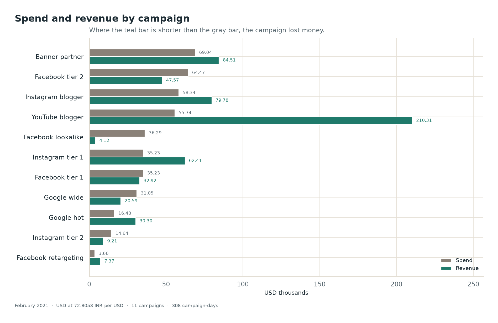
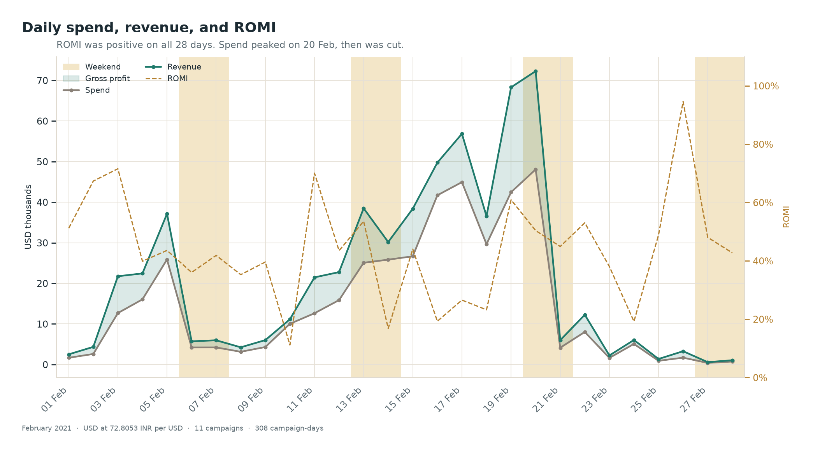

# Digital marketing campaign analysis

**Sonya Baigildin** · [github.com/SonyaBai](https://github.com/SonyaBai)

A performance account spent $420,173.84 across 11 campaigns in February 2021 and booked $589,096.75 of revenue. The blended return looks acceptable. The campaign mix does not. Five campaigns lost money, and one of them, YouTube blogger, produced 91.50% of the month's gross profit on 13.27% of the spend. This project measures where the return came from, where the funnel leaked, and which lines should be paused before another dollar is added. Figures below are US dollars.

## Dataset

Public Kaggle dataset [Analyze the Marketing Spending](https://www.kaggle.com/datasets/sinderpreet/analyze-the-marketing-spending) by sinderpreet, license [CC0](https://creativecommons.org/publicdomain/zero/1.0/). The file committed at `data/raw/Marketing.csv` is that extract, unchanged.

| | |
| --- | --- |
| Rows | 308 campaign-days |
| Campaigns | 11, one row each day |
| Window | 1–28 February 2021 |
| Currency in the raw file | INR, as recorded |
| Columns | `id`, `c_date`, `campaign_name`, `category`, `campaign_id`, `impressions`, `mark_spent`, `clicks`, `leads`, `orders`, `revenue` |

Categories in the file: social (6 campaigns), search (2), influencer (2), media (1).

## Currency conversion

The raw file stays in rupees. Every amount in the cleaned table, the database, the charts, and this write-up is US dollars.

The rate is **72.8053 INR per USD**, the February 2021 monthly average from the Federal Reserve Board's [G.5 Foreign Exchange Rates](https://www.federalreserve.gov/releases/g5/20210301/) release of 1 March 2021 (India, rupee). That average is the mean of daily noon buying rates for cable transfers in New York. The constant is `INR_PER_USD` in `src/constants.py`.

The Reserve Bank of India's Handbook of Statistics, [Table 204](https://www.rbi.org.in/scripts/PublicationsView.aspx?id=23378), reports 72.7565 for the same month (the average of the FBIL reference rate). This project uses the Federal Reserve figure only, so there is one rate.

Each campaign-day is divided by 72.8053 and rounded half-up to the cent. Totals are sums of those cents. Converting the month's rupee total in one step would give spend of $420,173.80; summing the rounded days gives **$420,173.84**. The four-cent gap is the rounding. Gross profit is revenue minus spend in cents, not a second conversion.

ROMI, CTR, and the two conversion rates do not depend on the currency. A constant rate cancels in ROMI, and the cent rounding does not move the portfolio, campaign, category, tier, targeting, or weekday rates at the precision shown here.

## Tools

Python (pandas, matplotlib, seaborn) for cleaning, metrics, and charts. SQLite for the same questions in SQL. Jupyter for the walkthrough in `notebooks/campaign_analysis.ipynb`.

## KPI definitions

Every rate is a **ratio of sums** over the rows in the group. It is not the average of daily rates. Days with zero leads or zero orders would make a daily ratio undefined, and a daily average would not match the month.

Gross profit here is **revenue minus media spend**. The file has no product cost, returns, or tax, so this is not accounting gross profit. CAC treats each order as one acquired customer. The file has no new-versus-returning flag.

| KPI | Formula |
| --- | --- |
| ROMI | (revenue − mark_spent) / mark_spent |
| CTR | clicks / impressions |
| Click-to-lead (conv1) | leads / clicks |
| Lead-to-order (conv2) | orders / leads |
| CPC | mark_spent / clicks |
| CPL | mark_spent / leads |
| CAC | mark_spent / orders |
| AOV | revenue / orders |
| Gross profit | revenue − mark_spent |
| Profit per order | gross profit / orders |
| CPM | mark_spent / impressions × 1,000 |

ROMI is shown as a percentage: 40.20% means the ratio is 0.4020. CTR is shown to three decimal places because it sits well below 1%. Other rates are shown to two decimal places. Money is rounded half-up to the cent. `python analysis.py` prints the figures below.

## Cleaning

The panel is already complete: 308 rows, no blank cells, no duplicate campaign-days, no negative metrics, and a funnel that never runs backwards (clicks ≤ impressions, leads ≤ clicks, orders ≤ leads). Revenue is zero on the same 19 rows where orders are zero.

The one defect is campaign-name casing. `facebOOK_tier2` appears on all 28 days of campaign_id `348934`. Every other name is already lowercase. The clean step lowercases the name to `facebook_tier2` and keeps the source text in `campaign_name_raw`. The campaign id does not change, so this is one campaign, not two.

Derived columns, saved in `data/processed/marketing_clean.csv`:

| Column | Rule |
| --- | --- |
| `platform` | facebook, instagram, google, youtube, or banner, from the campaign name |
| `city_tier` | `tier1` or `tier2` for the four city campaigns, otherwise `not_tiered` |
| `targeting` | see the targeting section; this is not a source column |
| `weekday`, `is_weekend` | Saturday and Sunday are the weekend. 1 February 2021 was a Monday |
| `gross_profit` | revenue − mark_spent, in USD |

## Portfolio

| Spend | Revenue | Gross profit | ROMI | Orders | CTR | Click-to-lead | Lead-to-order | CPC | CPL | CAC | AOV |
| --- | --- | --- | --- | --- | --- | --- | --- | --- | --- | --- | --- |
| $420,173.84 | $589,096.75 | $168,922.91 | 40.20% | 8,043 | 0.190% | 2.19% | 12.26% | $0.14 | $6.41 | $52.24 | $73.24 |

Impressions 1,577,722,399. Clicks 2,999,919. Leads 65,579. CPM $0.27.

The blended CTR is depressed by the banner. Banner partner is 67.71% of impressions at a 0.039% CTR. Without it, CTR is 0.506%. Click-to-lead moves from 2.19% to 2.15%, and lead-to-order from 12.26% to 11.69%. The banner's distortion is at the top of the funnel. The banner's own lead-to-order is 15.43%, so removing it lowers the close rate slightly.

## 1. ROMI by campaign


Six campaigns earned more than they spent. Five did not. The portfolio is profitable because the winners, YouTube especially, are larger than the losses.

| Campaign | Spend | Revenue | Gross profit | ROMI | Orders | Spend share |
| --- | --- | --- | --- | --- | --- | --- |
| YouTube blogger | $55,736.85 | $210,306.56 | $154,569.71 | 277.32% | 1,914 | 13.27% |
| Facebook retargeting | $3,660.00 | $7,374.73 | $3,714.73 | 101.50% | 108 | 0.87% |
| Google hot | $16,482.30 | $30,296.51 | $13,814.21 | 83.81% | 281 | 3.92% |
| Instagram tier 1 | $35,234.75 | $62,414.73 | $27,179.98 | 77.14% | 758 | 8.39% |
| Instagram blogger | $58,338.73 | $79,780.66 | $21,441.93 | 36.75% | 1,100 | 13.88% |
| Banner partner | $69,042.71 | $84,512.53 | $15,469.82 | 22.41% | 1,566 | 16.43% |
| Facebook tier 1 | $35,228.10 | $32,915.34 | −$2,312.76 | −6.57% | 474 | 8.38% |
| Facebook tier 2 | $64,471.55 | $47,569.42 | −$16,902.13 | −26.22% | 688 | 15.34% |
| Google wide | $31,047.22 | $20,593.52 | −$10,453.70 | −33.67% | 547 | 7.39% |
| Instagram tier 2 | $14,643.92 | $9,208.96 | −$5,434.96 | −37.11% | 313 | 3.49% |
| Facebook lookalike | $36,287.71 | $4,123.79 | −$32,163.92 | −88.64% | 294 | 8.64% |

YouTube blogger took 13.27% of spend, produced 35.70% of revenue, and produced 91.50% of gross profit. Influencer as a category (YouTube plus Instagram blogger) made $176,011.64. Social, search, and media together lost $7,088.73. The month's profit is an influencer result with a paid-media problem attached.

## 2. Performance by category

| Category | Spend | Revenue | Gross profit | ROMI | Orders | CTR | Lead-to-order | CAC | AOV |
| --- | --- | --- | --- | --- | --- | --- | --- | --- | --- |
| Influencer | $114,075.58 | $290,087.22 | $176,011.64 | 154.29% | 3,014 | 0.964% | 17.79% | $37.85 | $96.25 |
| Media | $69,042.71 | $84,512.53 | $15,469.82 | 22.41% | 1,566 | 0.039% | 15.43% | $44.09 | $53.97 |
| Search | $47,529.52 | $50,890.03 | $3,360.51 | 7.07% | 828 | 0.457% | 11.65% | $57.40 | $61.46 |
| Social | $189,526.03 | $163,606.97 | −$25,919.06 | −13.68% | 2,635 | 0.417% | 8.40% | $71.93 | $62.09 |

Social is 45.11% of spend and the only losing category. That is a mix result, not a reason to leave social. Instagram as a platform returned 39.91% (gross profit $43,186.95). Facebook returned −34.13% (gross profit −$47,664.08). Inside Facebook, retargeting returned 101.50%. Search looks almost flat at 7.07% only because Google wide (−33.67%) cancels most of Google hot (83.81%).

## 3. Funnel


| Step | Portfolio | Excluding banner |
| --- | --- | --- |
| Impressions → clicks (CTR) | 0.190% | 0.506% |
| Clicks → leads | 2.19% | 2.15% |
| Leads → orders | 12.26% | 11.69% |

Click-to-lead is the stable step. It sits between 1.47% and 2.55% on every campaign. The campaigns separate at CTR and, more importantly, at lead-to-order.

| Campaign | CTR | Click-to-lead | Lead-to-order | CPC | CPL |
| --- | --- | --- | --- | --- | --- |
| YouTube blogger | 1.030% | 2.21% | 19.27% | $0.12 | $5.61 |
| Facebook retargeting | 3.067% | 1.69% | 21.34% | $0.12 | $7.23 |
| Google hot | 1.945% | 2.04% | 15.33% | $0.18 | $8.99 |
| Instagram tier 1 | 0.359% | 2.46% | 11.43% | $0.13 | $5.31 |
| Instagram blogger | 0.879% | 2.34% | 15.70% | $0.19 | $8.32 |
| Banner partner | 0.039% | 2.42% | 15.43% | $0.16 | $6.80 |
| Facebook tier 1 | 0.381% | 1.47% | 13.41% | $0.15 | $9.97 |
| Facebook tier 2 | 0.474% | 2.55% | 8.16% | $0.20 | $7.65 |
| Google wide | 0.355% | 2.20% | 10.37% | $0.13 | $5.89 |
| Instagram tier 2 | 0.370% | 2.03% | 3.02% | $0.03 | $1.41 |
| Facebook lookalike | 0.945% | 1.59% | 15.40% | $0.30 | $19.01 |

Two different failure modes show up here. Instagram tier 2 is cheap (CPC $0.03, CPL $1.41) and then fails to close: 3.02% of leads become orders. Facebook lookalike is the opposite cost problem: CPC $0.30 and CPL $19.01, the worst prices in the account, and the orders that do arrive are worth $14.03.

## 4. Unit economics

A campaign loses money on the next order while CAC stays above AOV. Profit per order is gross profit divided by orders.

| Campaign | CPC | CPL | CAC | AOV | Profit per order |
| --- | --- | --- | --- | --- | --- |
| YouTube blogger | $0.12 | $5.61 | $29.12 | $109.88 | $80.76 |
| Facebook retargeting | $0.12 | $7.23 | $33.89 | $68.28 | $34.40 |
| Google hot | $0.18 | $8.99 | $58.66 | $107.82 | $49.16 |
| Instagram tier 1 | $0.13 | $5.31 | $46.48 | $82.34 | $35.86 |
| Instagram blogger | $0.19 | $8.32 | $53.04 | $72.53 | $19.49 |
| Banner partner | $0.16 | $6.80 | $44.09 | $53.97 | $9.88 |
| Facebook tier 1 | $0.15 | $9.97 | $74.32 | $69.44 | −$4.88 |
| Facebook tier 2 | $0.20 | $7.65 | $93.71 | $69.14 | −$24.57 |
| Google wide | $0.13 | $5.89 | $56.76 | $37.65 | −$19.11 |
| Instagram tier 2 | $0.03 | $1.41 | $46.79 | $29.42 | −$17.36 |
| Facebook lookalike | $0.30 | $19.01 | $123.43 | $14.03 | −$109.40 |



Google wide is not an expensive-click problem (CPC $0.13, close to the portfolio $0.14). The orders are worth $37.65 against a CAC of $56.76. Google hot, on the same platform, has a higher CPC ($0.18) and a much higher AOV ($107.82). Moving search budget from wide match to high intent is a value fix, not a bid-down.

Facebook tier 1 is the only loser close to the line: −$4.88 per order, ROMI −6.57%. A small improvement in AOV or in click-to-lead (its 1.47% is the weakest click-to-lead in the account) would flip it. It is a test, not a scale-up, and not the first thing to delete.

## 5. Tier 1 vs tier 2 cities

Only four campaigns carry a city tier: Facebook and Instagram, tier 1 and tier 2. The other seven are excluded from this comparison.


| | Spend | Revenue | Gross profit | ROMI | Orders | Lead-to-order | CAC | AOV |
| --- | --- | --- | --- | --- | --- | --- | --- | --- |
| Tier 1 | $70,462.85 | $95,330.07 | $24,867.22 | 35.29% | 1,232 | 12.12% | $57.19 | $77.38 |
| Tier 2 | $79,115.47 | $56,778.38 | −$22,337.09 | −28.23% | 1,001 | 5.32% | $79.04 | $56.72 |

Tier 2 spent more and closed half as often. The platform split matters more than the tier average:

| | ROMI | Lead-to-order | CAC | AOV | Gross profit |
| --- | --- | --- | --- | --- | --- |
| Instagram tier 1 | 77.14% | 11.43% | $46.48 | $82.34 | $27,179.98 |
| Facebook tier 1 | −6.57% | 13.41% | $74.32 | $69.44 | −$2,312.76 |
| Facebook tier 2 | −26.22% | 8.16% | $93.71 | $69.14 | −$16,902.13 |
| Instagram tier 2 | −37.11% | 3.02% | $46.79 | $29.42 | −$5,434.96 |

Instagram tier 1 is the city campaign worth keeping. Both Facebook city tiers lose money. Instagram tier 2's traffic is cheap and the leads do not become orders.

## 6. Retargeting, lookalike, and broad

Targeting is read from the campaign name. It is not a field in the extract.

| Targeting | Campaigns |
| --- | --- |
| Retargeting | Facebook retargeting |
| Lookalike | Facebook lookalike |
| Broad | Facebook tier 1, Facebook tier 2, Instagram tier 1, Instagram tier 2, Google wide, banner partner |
| High intent | Google hot. Search demand capture. Not included in broad. |
| Influencer | YouTube blogger, Instagram blogger. A channel, not an audience tactic. |


| Targeting | Spend | Revenue | Gross profit | ROMI | CTR | Lead-to-order | CAC | AOV |
| --- | --- | --- | --- | --- | --- | --- | --- | --- |
| Influencer | $114,075.58 | $290,087.22 | $176,011.64 | 154.29% | 0.964% | 17.79% | $37.85 | $96.25 |
| Retargeting | $3,660.00 | $7,374.73 | $3,714.73 | 101.50% | 3.067% | 21.34% | $33.89 | $68.28 |
| High intent | $16,482.30 | $30,296.51 | $13,814.21 | 83.81% | 1.945% | 15.33% | $58.66 | $107.82 |
| Broad | $249,668.25 | $257,214.50 | $7,546.25 | 3.02% | 0.136% | 9.79% | $57.45 | $59.18 |
| Lookalike | $36,287.71 | $4,123.79 | −$32,163.92 | −88.64% | 0.945% | 15.40% | $123.43 | $14.03 |

Read as a three-way comparison: retargeting returned 101.50%, broad returned 3.02%, lookalike returned −88.64%.

Retargeting is 0.87% of spend. Its CTR is 3.067% against a portfolio CTR of 0.190%, and 21.34% of its leads order. The pool is small: 976,685 impressions in the month. It can be tested at a multiple of its current budget. It cannot absorb the money currently wasted on lookalike.

Broad at 3.02% is a blend, not a verdict. It contains Instagram tier 1 and the banner, which make money, and the city and wide-match lines that do not. The pause list below is at campaign level on purpose.

Lookalike spent $36,287.71 to produce $4,123.79. Profit per order was −$109.40. Lead-to-order was an ordinary 15.40%. The audience is expensive, and the buyers are worth $14.03 against a portfolio AOV of $73.24.

## 7. Time



ROMI was positive on all 28 days. The best day was 26 February, 94.59% ROMI, on only $1,685.22 of spend. The worst day was 10 February, 11.15% ROMI, on $10,026.09. The peak was 20 February: spend $48,062.04, revenue $72,268.37, ROMI 50.36%, 1,023 orders. After that peak the account was cut hard. Daily orders move almost in lockstep with daily spend (correlation 0.99). Daily ROMI moves only mildly the other way (correlation −0.22).

| Half | Spend | Revenue | Gross profit | ROMI | Orders |
| --- | --- | --- | --- | --- | --- |
| 1–14 February | $164,139.99 | $234,190.23 | $70,050.24 | 42.68% | 3,206 |
| 15–28 February | $256,033.85 | $354,906.52 | $98,872.67 | 38.62% | 4,837 |

The second half spent more and gave a bit of efficiency back. That is consistent with a mild diminishing return, not with a broken second half.


February 2021 started on a Monday, so each weekday occurs four times. The totals below are comparable without a per-day adjustment. Per-day figures are shown for the weekend split because the two groups have different numbers of days (20 and 8).

| | Days | Spend | Spend per day | Gross profit | Gross profit per day | ROMI | Orders |
| --- | --- | --- | --- | --- | --- | --- | --- |
| Weekday | 20 | $307,519.39 | $15,375.97 | $121,311.07 | $6,065.55 | 39.45% | 5,763 |
| Weekend | 8 | $112,654.45 | $14,081.81 | $47,611.84 | $5,951.48 | 42.26% | 2,280 |

Weekend ROMI is 42.26% against a weekday 39.45%. Gross profit per day is $5,951.48 against $6,065.55. There is no case for moving the budget onto the weekend as a block.

| Weekday | Spend | Gross profit | ROMI | Orders |
| --- | --- | --- | --- | --- |
| Monday | $39,474.30 | $17,934.42 | 45.43% | 765 |
| Tuesday | $50,217.83 | $12,106.39 | 24.11% | 861 |
| Wednesday | $72,704.75 | $23,082.15 | 31.75% | 1,349 |
| Thursday | $59,237.24 | $22,569.55 | 38.10% | 1,114 |
| Friday | $85,885.27 | $45,618.56 | 53.12% | 1,674 |
| Saturday | $77,734.24 | $39,336.94 | 50.60% | 1,629 |
| Sunday | $34,920.21 | $8,274.90 | 23.70% | 651 |

Friday and Saturday are the efficient, high-volume days. Sunday is not Saturday: it has the lowest spend ($34,920.21) and a 23.70% ROMI, close to Tuesday's 24.11% on $50,217.83 of spend.

## 8. Budget recommendation

Pause four campaigns. Each has CAC above AOV by a wide margin, so another order at the current rate makes the loss worse.

| Pause | Spend released | Gross profit removed | Why |
| --- | --- | --- | --- |
| Facebook lookalike | $36,287.71 | −$32,163.92 | CAC $123.43 vs AOV $14.03. Worst CPC and CPL in the account. |
| Facebook tier 2 | $64,471.55 | −$16,902.13 | 15.34% of the budget. CAC $93.71 vs AOV $69.14. |
| Google wide | $31,047.22 | −$10,453.70 | Same channel as Google hot, much lower AOV ($37.65 vs $107.82). |
| Instagram tier 2 | $14,643.92 | −$5,434.96 | Lead-to-order 3.02%. Cheap clicks, orders worth $29.42. |

Together that is $146,450.40 of spend, 34.85% of the month, $81,495.69 of revenue, and 1,842 orders. Those orders were unprofitable. Dropping the four lines and leaving everything else exactly as it ran:

| | Spend | Revenue | Gross profit | ROMI | Orders |
| --- | --- | --- | --- | --- | --- |
| February, as run | $420,173.84 | $589,096.75 | $168,922.91 | 40.20% | 8,043 |
| After the four pauses | $273,723.44 | $507,601.06 | $233,877.62 | 85.44% | 6,201 |

Gross profit rises by $64,954.71, which is exactly the loss those four lines posted. No scale-up is assumed. This is the recommendation that the observed rows support on their own.

What to do with the freed $146,450.40 is a test design, not a forecast. The weights below are a planning choice. They are not the output of an optimiser. YouTube already works at $55,736.85 and should take the largest share, not the whole budget, because influencer inventory does not scale like an auction. Retargeting is set at $14,645.04, four times its February spend of $3,660.00, because the month produced only 976,685 retargeting impressions. Google hot receives the budget Google wide was wasting, inside the same channel. Instagram tier 1 is the scalable paid-social cell.

| Destination | Share of freed spend | Added spend | Observed ROMI | Incremental gross profit if that ROMI holds | Projected extra orders |
| --- | --- | --- | --- | --- | --- |
| YouTube blogger | 40% | $58,580.16 | 277.32% | $162,454.79 | 2,011.64 |
| Instagram tier 1 | 30% | $43,935.12 | 77.14% | $33,891.42 | 945.17 |
| Google hot | 20% | $29,290.08 | 83.81% | $24,548.72 | 499.35 |
| Facebook retargeting | 10% | $14,645.04 | 101.50% | $14,864.04 | 432.15 |
| Total | 100% | $146,450.40 | | $235,758.97 | |

If those rates survived the extra spend, the full book (same $420,173.84 of spend, losers replaced by the four destinations) would show gross profit of $469,636.59 and ROMI of 111.77%. Treat that as a ceiling. The daily correlation between spend and ROMI is −0.22, so a larger budget should be expected to give something back. The pause case, at 85.44% ROMI and $233,877.62 of gross profit, does not depend on that assumption.

Hold, do not scale:

- **Facebook tier 1.** Spend stays at $35,228.10. It loses $4.88 per order. Give it a creative and landing test with a stop if ROMI is still negative. Do not add budget first.
- **Banner partner.** ROMI 22.41% is real, and so is a 0.039% CTR and the thinnest profit per order among the winners ($9.88). It already takes 16.43% of spend. Refresh the creative before adding impressions.
- **Instagram blogger.** ROMI 36.75% is healthy and already a large line ($58,338.73). Keep it. The next incremental dollar is better tested on YouTube, which returned 277.32% on a similar influencer job.

Two operating notes from the calendar. Do not move budget onto "the weekend": Sunday's 23.70% ROMI undoes the story, and profit per day is flat. Do smooth the flight. The account scaled into $48,062.04 on 20 February, still at 50.36% ROMI, and then went quiet. Retargeting and Google hot should not be switched off in that cut.

## How to run

Python 3.11 or newer.

```bash
python -m venv .venv
source .venv/bin/activate
pip install -r requirements.txt
python analysis.py
```

`python analysis.py` rewrites `data/processed/marketing_clean.csv`, the seven charts in `images/`, and `data/marketing.db`, then prints every figure in this file. The database is gitignored. Rebuild it on its own with:

```bash
python sql/load_sqlite.py
sqlite3 -header -column data/marketing.db < sql/01_romi.sql
```

The other questions are `sql/02_category.sql` through `sql/08_reallocation.sql`. Open `notebooks/campaign_analysis.ipynb` for the same path with the tables and charts inline. Re-execute it from the repository root.

## Repository

```
.
├── analysis.py                 # entry point
├── data/
│   ├── raw/Marketing.csv       # source extract, unchanged
│   └── processed/marketing_clean.csv
├── images/                     # seven charts embedded above
├── notebooks/campaign_analysis.ipynb
├── sql/
│   ├── schema.sql
│   ├── load_sqlite.py
│   └── 01_romi.sql … 08_reallocation.sql
├── src/                        # cleaning, metrics, charts
├── requirements.txt
└── LICENSE                     # MIT, Sonya Baigildin, 2026
```

`data/marketing.db` is created locally and is not committed.

## Caveats

- One market, one month, observational data. Nothing here is an incrementality test.
- The constant-ROMI reallocation is an upper bound. Marginal CPC can rise, and the retargeting pool can run out.
- Gross profit ignores product cost. A campaign with a high AOV can still be a poor order if the goods are expensive. That cost is not in the file.
- CAC is spend per order, not spend per new customer.
- Retargeting and lookalike exist only as Facebook campaigns. Comparing them with broad targeting mixes platforms. The campaign table is the safer cut.
- Banner impressions dominate CTR. Quote the excluding-banner CTR next to the blended one.
